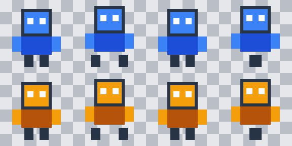

# FrameTailor

An offline, engine-independent CLI for transforming existing sprite sheets while preserving animation metadata. It supports exact palette swaps and binary-mask compositing of externally generated candidates; AI generation is not implemented. Python 3.11+ and Pillow are the only runtime requirements.

```sh
python3 -m venv .venv
. .venv/bin/activate
pip install -e .
frametailor transform examples/robot/animation.json \
  --config examples/robot/transform.json --out output/robot
frametailor validate examples/robot/animation.json output/robot/animation.json
python -m unittest discover -s tests -v
```

Use a fresh output directory. `python -m frametailor` also works from the repository with Pillow installed.



Input is a static PNG sheet and a [JSON manifest](examples/robot/animation.json) declaring frame ids, rectangles, durations, anchors and looping. Frames may use any nonoverlapping layout. [Palette mappings](examples/robot/transform.json) apply simultaneously, preserving alpha and unmapped colors.

Output includes the transformed sheet, frame PNGs, unchanged animation metadata, an APNG preview, source/output comparison, validation report, portable inputs and SHA-256 provenance. Identical inputs and runtime versions produce identical bundles. The manifest and individual PNGs are authoritative: APNG can merge adjacent identical frames, and previews are omitted for unequal frame sizes. Loose-frame and animated-image imports are not supported yet.

## Outfit candidate checks

The [original outfit example](examples/outfit/) provides four distinct asymmetric 64×64 walking frames, a jacket reference, a source-authored clothing mask, and [acceptance criteria](examples/outfit/acceptance.json). Regenerate it into a fresh directory:

```sh
python -m examples.generate_outfit_fixture --out output/outfit-source
```

To check a separately obtained candidate sheet and manifest:

```sh
frametailor validate examples/outfit/animation.json output/candidate/animation.json \
  --profile outfit-regions-v1 --editable-mask examples/outfit/editable-mask.png
```

The default `exact-alpha-v1` profile preserves every alpha byte. The separate `outfit-regions-v1` profile permits RGB/alpha edits only in white mask regions; every other pixel and all animation metadata must remain identical. It rejects unchanged/source-substituted and duplicate candidate frames for this distinct-pose benchmark. It never repairs or realigns output.

A successful outfit check means only that these constraints passed. Reports always set `approved: false`; pose, movement, genuine garment changes, cross-frame identity/clothing consistency and provider success still require review. Provider logs must establish successful completion and correct response order; pixel checks cannot establish that. Masks must be static binary grayscale PNGs authored against the source, never derived from a candidate. Provenance hashes are recorded but not automatically verified.

## Masked compositing

```sh
frametailor composite examples/outfit/animation.json output/candidate/animation.json \
  --editable-mask examples/outfit/editable-mask.png --out output/composited
```

Candidate metadata and sheet dimensions must match the source. White mask pixels copy all candidate RGBA channels exactly; black pixels preserve all source channels exactly. Transparent candidate pixels can erase source art inside the mask, and white regions over transparent source permit explicit silhouette expansion. Masks are never enlarged; there is no alpha blending, cleanup or automatic alignment.

The review bundle retains the input candidate separately and includes frame PNGs, an APNG preview, a three-column original/candidate/composite comparison, pixel-change maps, per-frame transfer/discard counts, both validation profiles and provenance hashes. `transferred_changed_pixels` counts selected pixels that differ from source; `authorized_pixels` also includes unchanged copies. Discarded-expansion maps flag possible clipping, not semantic clothing loss. Inspect collar, sleeve and hem boundaries yourself. Exit status reports outfit structural validity, and `approved` always remains false. Exact-alpha may fail for authorized clothing/silhouette changes.

All example artwork is original and programmatically drawn under [Apache-2.0](LICENSE). No game artwork, engine dependencies, service credentials or paid providers are included.
